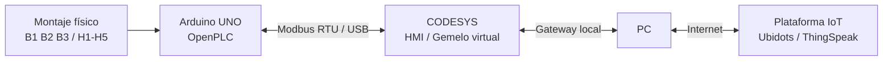

# RA3.2 - Gemelo Digital del control de nivel de un tanque

> **Estado:** implementación en curso · **Entrega:** 3 de noviembre de 2026

Esta actividad extiende el sistema desarrollado en **RA2.3** para convertirlo en un **gemelo digital**, integrando el activo físico, la HMI de CODESYS, comunicación Modbus y una plataforma IoT.

## 1. Objetivo

Integrar el montaje físico del control de nivel de tanque con su representación virtual en CODESYS, utilizando un microcontrolador Arduino y el protocolo Modbus para intercambiar información entre ambos activos. Como etapa final, el estado del tanque será publicado en una plataforma IoT y se habilitará al menos una acción de control remoto.

## 2. Activo físico reutilizado de RA2.3

El montaje físico utiliza un **Arduino UNO** conectado a una protoboard con las siguientes señales:

### Entradas

| Señal | Pin Arduino | Función |
|---|---:|---|
| START | D2 | Inicio / enclavamiento del sistema |
| STOP | D3 | Parada del sistema |
| B1 | D4 | Sensor de nivel inferior |
| B2 | D5 | Sensor de nivel intermedio |
| B3 | D6 | Sensor de nivel superior |

### Salidas

| Señal | Pin Arduino | Estado representado |
|---|---:|---|
| H1 | D8 | Nivel correcto |
| H2 | D9 | Nivel bajo |
| H3 | D10 | Nivel alto |
| H4 | D11 | Tanque vacío |
| H5 | D12 | Error de secuencia de sensores |

El montaje físico fue reconstruido y validado nuevamente para RA3.2. Actualmente las entradas de nivel y las cinco salidas visuales responden a la lógica implementada. El pulsador STOP continúa en ajuste físico, sin afectar la validación de las combinaciones de nivel.

## 3. Lógica del proceso

La lógica mantiene el comportamiento definido en RA2.3:

| B1 | B2 | B3 | Resultado |
|---:|---:|---:|---|
| 0 | 0 | 0 | H4 - Tanque vacío |
| 1 | 0 | 0 | H2 - Nivel bajo |
| 1 | 1 | 0 | H1 - Nivel correcto |
| 1 | 1 | 1 | H3 - Nivel alto |
| 0 | 1 | 0 | H5 - Error |
| 0 | 0 | 1 | H5 - Error |
| 1 | 0 | 1 | H5 - Error |
| 0 | 1 | 1 | H5 - Error |

La combinación `000` representa tanque vacío y **no se considera error**.

## 4. Activo virtual

El activo virtual corresponde a la HMI desarrollada previamente en **CODESYS**. Esta representa:

- Estado de marcha del proceso.
- Señales B1, B2 y B3.
- Estados H1, H2, H3, H4 y H5.
- Secuencia lógica del nivel del tanque.

Para RA3.2 la HMI se reutiliza y se prepara para recibir los estados reales mediante Modbus, de modo que la visualización refleje el comportamiento del activo físico.

## 5. Arquitectura propuesta del gemelo digital



La arquitectura se planteó para reutilizar el hardware disponible. El computador funciona como gateway hacia Internet, evitando requerir un ESP32 adicional.

## 6. Integración Modbus

Se creó una variante del proyecto OpenPLC denominada **`Tanque_V2_Modbus`**, manteniendo la lógica original y agregando un servidor **Modbus RTU** sobre la comunicación USB del Arduino.

### Parámetros de comunicación

- **Protocolo:** Modbus RTU
- **Unit / Slave ID:** 1
- **Baud rate:** 115200
- **Data bits:** 8
- **Parity:** None
- **Stop bits:** 1

### Mapeo propuesto

#### Discrete Inputs - FC02

| Dirección Modbus | Variable | Dirección IEC | Pin |
|---:|---|---|---:|
| 0 | START | `%IX0.0` | D2 |
| 1 | STOP | `%IX0.1` | D3 |
| 2 | B1 | `%IX0.2` | D4 |
| 3 | B2 | `%IX0.3` | D5 |
| 4 | B3 | `%IX0.4` | D6 |

#### Coils - FC01

| Dirección Modbus | Variable | Dirección IEC | Pin |
|---:|---|---|---:|
| 0 | H1 | `%QX0.0` | D8 |
| 1 | H2 | `%QX0.1` | D9 |
| 2 | H3 | `%QX0.2` | D10 |
| 3 | H4 | `%QX0.3` | D11 |
| 4 | H5 | `%QX0.4` | D12 |

La variante con Modbus fue cargada en el Arduino y el comportamiento físico del tanque continuó funcionando correctamente, por lo que la lógica de RA2.3 se conserva durante la integración.

## 7. Integración con CODESYS

La siguiente fase consiste en configurar CODESYS como cliente Modbus RTU mediante el puerto COM del Arduino.

Estructura prevista:

```text
Device
└── Modbus COM Port
    └── Modbus Serial Client
        └── Arduino / Modbus Serial Server
```

Se utilizarán dos grupos de lectura:

1. **FC02 - Read Discrete Inputs**
   - Offset: 0
   - Longitud: 5
   - Variables: START, STOP, B1, B2 y B3.

2. **FC01 - Read Coils**
   - Offset: 0
   - Longitud: 5
   - Variables: H1, H2, H3, H4 y H5.

> **Estado actual:** configuración de la comunicación CODESYS ↔ Arduino en proceso.

## 8. Integración IoT

La etapa IoT se implementará utilizando el computador como gateway. La propuesta es publicar un valor numérico asociado al estado del tanque y disponer de una variable de control remoto.

### Codificación prevista del estado

| Valor | Estado |
|---:|---|
| 0 | Sistema detenido / sin estado |
| 1 | Tanque vacío |
| 2 | Nivel bajo |
| 3 | Nivel correcto |
| 4 | Nivel alto |
| 5 | Error de secuencia |

Se evaluará **Ubidots STEM** como plataforma principal y **ThingSpeak** como alternativa, de acuerdo con la estabilidad de la integración durante la implementación.

## 9. Validación

Las pruebas funcionales del activo físico ya verificaron las transiciones principales:

- `000 → H4` tanque vacío.
- `100 → H2` nivel bajo.
- `110 → H1` nivel correcto.
- `111 → H3` nivel alto.
- Combinaciones incoherentes → `H5`.

La validación final de RA3.2 incluirá la comparación simultánea entre:

1. Estado físico del montaje.
2. Estado recibido y mostrado en CODESYS.
3. Estado publicado en la plataforma IoT.
4. Respuesta del sistema ante una orden enviada desde la plataforma IoT.

## 10. Evidencias pendientes de incorporar

- Fotografía final del montaje físico.
- Captura del proyecto `Tanque_V2_Modbus`.
- Captura de configuración Modbus en CODESYS.
- Captura online de las variables cambiando desde el montaje físico.
- Captura de la HMI reflejando el mismo estado.
- Dashboard de la plataforma IoT.
- Evidencia de una modificación remota del estado/control.

## 11. Estado de avance

| Fase | Estado |
|---|---|
| Activo físico RA2.3 | ✅ Funcional |
| Lógica OpenPLC | ✅ Validada |
| HMI CODESYS | ✅ Disponible desde RA2.3 |
| OpenPLC + Modbus RTU | ✅ Configurado y cargado |
| Arduino ↔ CODESYS | 🟡 En implementación |
| Publicación IoT | ⏳ Pendiente |
| Control desde IoT | ⏳ Pendiente |
| Validación integral | ⏳ Pendiente |

---

**Autor:** Nicolás García Mejía  
**Actividad:** RA3.2 - Digital Twin - IoT Ecosystem  
**Fecha de sustentación:** 3 de noviembre de 2026
